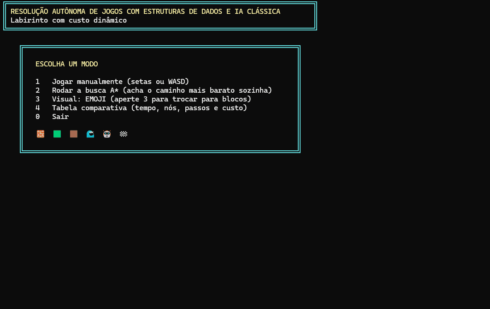

# Autonomous Game Solving with Data Structures and Classical AI

🇧🇷 [Leia em português](README.pt-BR.md)

A maze with **weighted terrain** written in C from scratch and solved by the **A\*** search algorithm, with a live terminal animation of the search. The robot must go from the top left corner to the bottom right corner along the **cheapest** path, which is often not the shortest one.



| Terrain | Cost |
|---|---|
| 🧱 Wall | blocked |
| 🟩 Clean floor | 1 |
| 🟫 Mud | 3 |
| 🌊 Water | 5 |

## Technical highlights

* **A\* implemented from scratch in C**, with no external libraries: nodes in a linked list, dynamic memory with `malloc` and `free`, and path reconstruction through parent pointers.
* **Formal problem modeling:** state space, valid transitions, and a **proof that the Manhattan heuristic is admissible and consistent**, which guarantees the optimal path.
* **Performance benchmarking:** a built in mode runs every maze 1000 times with and without the heuristic and reports execution time (ms), expanded nodes, generated nodes, solution depth, path cost and memory usage.
* **Memory safety verified** with AddressSanitizer: no leaks across 6000 consecutive searches.
* **Completeness tested:** when the goal is unreachable, the search terminates and reports that no path exists.
* **Separation of concerns:** the algorithm is independent from the rendering layer, and all Windows specific calls are isolated behind `#ifdef _WIN32`.

## Features

1. **Manual mode:** drive the robot with the arrow keys. Every move is stored in a **queue**, and at the end your cost is compared with the optimal cost found by A\*.
2. **A\* search mode:** watch the open list (🟦), the closed list (🔍), the final path (👣) and the robot walking it, followed by the execution time and a comparison with the same search without a heuristic.
3. **Visual toggle:** emoji or colored blocks, for consoles without emoji support.
4. **Benchmark table:** all metrics for all mazes on one screen.

Three difficulty levels: **easy** (8x8, open field), **medium** (12x12, zigzag corridor) and **hard** (17x17, branching maze with loops).

## How A\* works here

Each discovered cell becomes a `NoBusca` node holding `g` (real cost from the start), `h` (heuristic estimate to the goal), `f = g + h`, a `fechado` (closed) flag and an `anterior` (parent) pointer.

At every step, `menorF` picks the open node with the lowest `f` from the **whole list**, wherever it is on the map. That is how the search abandons a path that became expensive and continues from a better candidate, without walking back. When the goal is selected, the path is rebuilt by following the parent pointers.

**Heuristic:** Manhattan distance, `h = |row − goalRow| + |col − goalCol|`. Each move changes this distance by at most 1 and every move costs at least 1, so `h` never overestimates the real cost.

## Results

| Maze | Search | Time (ms) | Expanded | Generated | Steps | Cost |
|---|---|---|---|---|---|---|
| Easy 8x8 | A\* | 0.0027 | 19 | 28 | 14 | 14 |
| Easy 8x8 | h = 0 (Dijkstra) | 0.0086 | 42 | 47 | 14 | 14 |
| Medium 12x12 | A\* | 0.0170 | 71 | 74 | 58 | 58 |
| Medium 12x12 | h = 0 (Dijkstra) | 0.0193 | 75 | 77 | 58 | 58 |
| Hard 17x17 | A\* | 0.0525 | 120 | 132 | 40 | 58 |
| Hard 17x17 | h = 0 (Dijkstra) | 0.0959 | 167 | 170 | 40 | 58 |

* A\* always reaches the same optimal cost as Dijkstra while expanding up to **55% fewer nodes** and running up to **69% faster**.
* **Cheapest is not shortest:** in the medium maze the path with the fewest steps (22) would cost **92**, while A\* takes 58 steps for a cost of **58**.

The full analysis (modeling, admissibility proof, completeness, optimality and complexity) is in the [report (Portuguese)](Relatorio_Resolucao_Autonoma_de_Jogos.pdf).

## Data structures

* **Matrix** for the maze;
* **Struct + singly linked list** with dynamic allocation for the search nodes;
* **Queue** (`FILA.h`) for the move history in manual mode;
* **Modular functions**, with the visual layer separated from the algorithm.

## Build and run

**Code::Blocks (Windows):** put `labirinto_astar.c` and `FILA.h` in the same folder, open the `.c` file and press **F9**.

**GCC:**

```
gcc labirinto_astar.c -o labirinto
./labirinto
```

On Windows the program reopens itself in **Windows Terminal** when it is installed, where emoji are rendered in color.

| Key | Action |
|---|---|
| Arrows or W A S D | Move (manual mode) |
| Q or ESC | Quit the game |
| 1, 2, 3, 4, 0 | Menu options |

## Author

* **Giovanni Ferigato Siqueira**

Data Science and Artificial Intelligence, PUC-Campinas, Brazil, 2026. Courses: Computational Artificial Intelligence and Programming and Data Structures.
