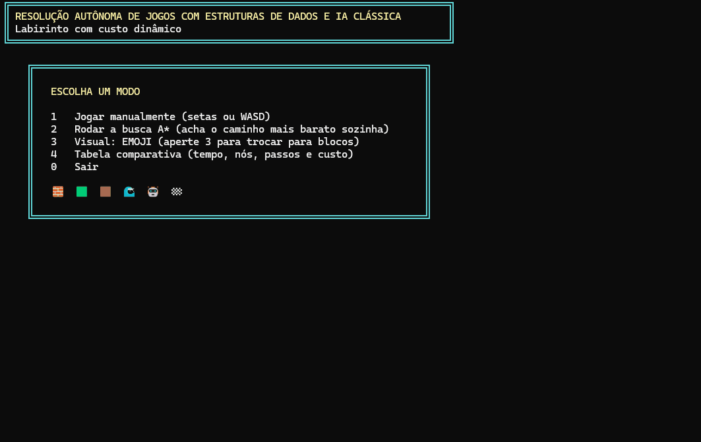

# Resolução Autônoma de Jogos com Estruturas de Dados e IA Clássica

🇺🇸 [Read in English](README.md)

Labirinto com **custo dinâmico** escrito em C do zero e resolvido pelo algoritmo de busca **A\***, com animação da busca no terminal. O robô precisa ir do canto superior esquerdo ao canto inferior direito pelo caminho **mais barato**, que muitas vezes não é o mais curto.



| Terreno | Custo |
|---|---|
| 🧱 Parede | bloqueada |
| 🟩 Chão limpo | 1 |
| 🟫 Lama | 3 |
| 🌊 Água | 5 |

## Destaques técnicos

* **A\* implementado do zero em C**, sem bibliotecas externas: nós numa lista encadeada, memória dinâmica com `malloc` e `free` e reconstrução do caminho por ponteiros.
* **Modelagem formal do problema:** espaço de estados, transições válidas e **prova de que a heurística de Manhattan é admissível e consistente**, o que garante o caminho ótimo.
* **Medição de desempenho:** um modo do programa roda cada labirinto 1000 vezes, com e sem heurística, e mostra tempo de execução (ms), nós expandidos, nós gerados, profundidade, custo e memória.
* **Memória verificada** com AddressSanitizer: nenhum vazamento em 6000 buscas seguidas.
* **Completude testada:** quando a chegada é inalcançável, a busca termina e informa que não existe caminho.
* **Separação de responsabilidades:** o algoritmo é independente da parte visual, e as chamadas específicas do Windows ficam isoladas em `#ifdef _WIN32`.

## O que o programa faz

1. **Jogo manual:** você conduz o robô com as setas. Cada movimento é guardado numa **fila**, e no final o seu custo é comparado com o custo ótimo do A\*.
2. **Busca A\*:** mostra a lista aberta (🟦), a lista fechada (🔍), o caminho final (👣) e o robô percorrendo esse caminho. No fim aparecem o tempo de execução e a comparação com a busca sem heurística.
3. **Visual:** emoji ou blocos coloridos, para consoles sem suporte a emoji.
4. **Tabela comparativa:** todas as métricas de todos os labirintos em uma tela.

Três níveis: **fácil** (8x8, campo aberto), **médio** (12x12, corredor em zigue zague) e **difícil** (17x17, labirinto com bifurcações e ciclos).

## Como o A\* funciona aqui

Cada casa descoberta vira um nó `NoBusca` com `g` (custo real desde o início), `h` (estimativa até a chegada), `f = g + h`, o indicador `fechado` e o ponteiro `anterior`.

A cada passo, `menorF` escolhe o nó aberto de menor `f` **da lista inteira**, esteja ele onde estiver no mapa. É assim que a busca abandona um caminho que ficou caro e continua por uma candidata melhor, sem voltar andando. Quando a chegada é escolhida, o caminho é montado seguindo os ponteiros `anterior`.

**Heurística:** distância de Manhattan, `h = |linha − linhaFim| + |coluna − colunaFim|`. Cada movimento muda essa distância em no máximo 1 e todo movimento custa pelo menos 1, então `h` nunca superestima o custo real.

## Resultados

| Labirinto | Busca | Tempo (ms) | Expandidos | Gerados | Passos | Custo |
|---|---|---|---|---|---|---|
| Fácil 8x8 | A\* | 0,0027 | 19 | 28 | 14 | 14 |
| Fácil 8x8 | h = 0 (Dijkstra) | 0,0086 | 42 | 47 | 14 | 14 |
| Médio 12x12 | A\* | 0,0170 | 71 | 74 | 58 | 58 |
| Médio 12x12 | h = 0 (Dijkstra) | 0,0193 | 75 | 77 | 58 | 58 |
| Difícil 17x17 | A\* | 0,0525 | 120 | 132 | 40 | 58 |
| Difícil 17x17 | h = 0 (Dijkstra) | 0,0959 | 167 | 170 | 40 | 58 |

* O A\* sempre chega ao mesmo custo ótimo que o Dijkstra, expandindo até **55% menos nós** e rodando até **69% mais rápido**.
* **O mais barato não é o mais curto:** no labirinto médio, o caminho com menos passos (22) custaria **92**; o A\* faz 58 passos com custo **58**.

A análise completa (modelagem, prova da heurística, completude, otimalidade e complexidade) está no [relatório](Relatorio_Resolucao_Autonoma_de_Jogos.pdf).

## Estruturas de dados

* **Matriz** para o labirinto;
* **struct e lista encadeada** com alocação dinâmica para os nós da busca;
* **Fila** (`FILA.h`) para o histórico do jogo manual;
* **Modularização** em funções, com a parte visual separada do algoritmo.

## Como compilar e rodar

**CodeBlocks (Windows):** coloque `labirinto_astar.c` e `FILA.h` na mesma pasta, abra o `.c` e aperte **F9**.

**GCC:**

```
gcc labirinto_astar.c -o labirinto
./labirinto
```

No Windows, o programa se reabre sozinho no **Windows Terminal** quando ele está instalado, onde os emoji aparecem coloridos.

| Tecla | Ação |
|---|---|
| Setas ou W A S D | Andar (jogo manual) |
| Q ou ESC | Sair do jogo |
| 1, 2, 3, 4, 0 | Opções do menu |

## Autor

* **Giovanni Ferigato Siqueira**

Ciência de Dados e Inteligência Artificial, PUC-Campinas, 2026. Disciplinas: Inteligência Artificial Computacional e Programação e Estrutura de Dados.
